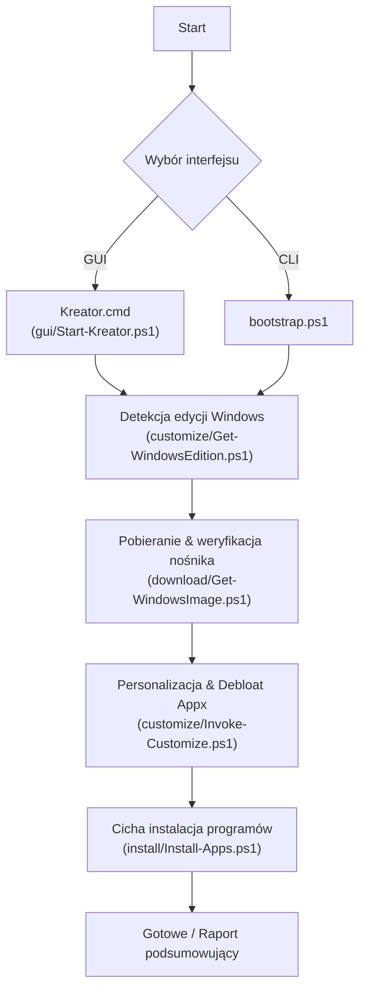

# konfigurator-win

<p align="center">
  
  
  
  
  
  
</p>

<p align="center">
  <b>Profesjonalny zestaw narzędzi PowerShell oraz interfejs graficzny do kompleksowej automatyzacji, personalizacji oraz debloatu świeżo zainstalowanego systemu Windows 10 i 11.</b>
</p>

---

## 📋 Spis treści

- [O projekcie](#-o-projekcie)
- [Główne możliwości](#-główne-możliwości)
- [Architektura procesu](#-architektura-procesu)
- [Struktura katalogów](#-struktura-katalogów)
- [Wymagania systemowe](#-wymagania-systemowe)
- [Szybki start](#-szybki-start)
  - [Opcja A: Kreator graficzny (GUI Windows)](#opcja-a-kreator-graficzny-gui-windows)
  - [Opcja B: Wiersz poleceń (CLI Windows)](#opcja-b-wiersz-poleceń-cli-windows)
  - [Opcja C: Nośnik USB z Linuksa / macOS (`konfigurator.sh`)](#opcja-c-nośnik-usb-z-linuksa--macos-konfiguratorsh)
- [Przewodnik konfiguracji](#-przewodnik-konfiguracji)
  - [Personalizacja systemu (`settings.json`)](#personalizacja-systemu-settingsjson)
  - [Usuwanie aplikacji bloatware (`bloatware.txt`)](#usuwanie-aplikacji-bloatware-bloatwaretxt)
  - [Zestaw aplikacji (`apps.json`)](#zestaw-aplikacji-appsjson)
- [Parametry skryptu `bootstrap.ps1`](#-parametry-skryptu-bootstrapps1)
- [Bezpieczeństwo i transparentność](#-bezpieczeństwo-i-transparentność)
- [Plany rozwojowe (Backlog)](#-plany-rozwojowe-backlog)
- [Inspiracja](#-inspiracja)
- [Często zadawane pytania (FAQ)](#-często-zadawane-pytania-faq)
- [Współtworzenie](#-współtworzenie)
- [Autor](#-autor)
- [Licencja](#-licencja)

---

## 💡 O projekcie

**konfigurator-win** powstał w celu skrócenia czasu wdrożenia i konfiguracji systemu operacyjnego Windows na stacjach roboczych i komputerach prywatnych. Narzędzie łączy w sobie pobieranie oficjalnych nośników, czyszczenie systemu z niechcianych aplikacji OEM/Microsoftu, optymalizację ustawień interfejsu oraz cichą instalację niezbędnego oprogramowania.

Projekt oferuje dwa równorzędne sposoby obsługi:
1. **Tryb graficzny (Kreator GUI)** – okienkowy asystent krok po kroku (`Kreator.cmd`), idealny do szybkiej pracy bez konieczności edycji plików tekstowych.
2. **Tryb wsadowy / CLI (`bootstrap.ps1`)** – w pełni skryptowalne, powtarzalne środowisko automatyzacji dla administratorów i techników IT.

W przeciwieństwie do wielu nieprzejrzystych skryptów dostępnych w sieci:
- **Domyślnie działa w trybie podglądu (`-WhatIf` / Dry-Run)**: nie wprowadzi żadnych zmian bez Twojej wyraźnej decyzji.
- **Korzysta wyłącznie z oficjalnych kanałów Microsoftu**: żadnych nieoficjalnych mirrorów ISO ani modyfikowanych instalatorów.
- **Jest w pełni modułowy i transparentny**: każdy komponent można uruchomić niezależnie, a kod jest otwarty i przejrzyście skomentowany.

---

## ⚡ Główne możliwości

- 🖥️ **Wygodny Kreator Graficzny (Windows Forms)**: Prosty w obsłudze interfejs z podglądem na żywo, możliwością odznaczenia niechcianych programów i paskiem postępu.
- 🔍 **Precyzyjna inspekcja środowiska**: Automatyczne rozpoznawanie architektury, edycji (Home / Pro), numeru kompilacji i wydania (np. 23H2, 24H2) oraz uprawnień administratora.
- 🧹 **Dwuetapowy Debloat Appx**: Usuwanie zbędnych aplikacji zarówno z profilu bieżącego użytkownika (`Remove-AppxPackage`), jak i z obrazu aprowizowanego systemu (`Remove-AppxProvisionedPackage`), co zapobiega ich powracaniu przy tworzeniu nowych kont.
- 🎨 **Optymalizacja interfejsu & UX**:
  - Automatyczne przełączanie na **ciemny motyw** (Dark Mode) dla aplikacji i powłoki systemowej.
  - Wyrównanie paska zadań do lewej strony (w stylu klasycznym) w Windows 11.
  - Włączenie widoczności rozszerzeń plików (`.exe`, `.iso`, itp.) oraz ukrytych folderów.
  - Wyłączenie widżetów na pasku zadań.
- 🛡️ **Prywatność**:
  - Wyłączenie wyników wyszukiwania Bing i reklam w menu Start.
  - Ograniczenie telemetrii do poziomu minimalnego.
- 📦 **Cicha instalacja programów (winget)**:
  - Automatyczna instalacja ulubionych narzędzi (przeglądarki, edytory, kodeki, narzędzia diagnostyczne).
  - Weryfikacja obecności oprogramowania przed instalacją (unikanie zbędnych pobrań).
  - Opcja automatycznej aktualizacji zainstalowanych programów (`-UpgradeApps`).
- 💿 **Oficjalny asystent ISO**:
  - Bezpośrednie pobieranie oficjalnego narzędzia Media Creation Tool.
  - Weryfikacja integralności sum kontrolnych SHA-256 dla pobranych obrazów.

---

## 🔄 Architektura procesu



---

## 📂 Struktura katalogów

```
konfigurator-win/
├── Kreator.cmd                   # Launcher asystenta graficznego (dwuklik w Windows)
├── bootstrap.ps1                 # Główny orkiestrator CLI całego procesu (Windows)
├── konfigurator.sh               # Wieloplatformowy kreator nośnika USB (Linux / macOS)
├── README.md                     # Dokumentacja główna projektu
├── LICENSE                       # Licencja MIT
├── CHANGELOG.md                  # Historia wydań i zmian
├── CONTRIBUTING.md               # Wytyczne dla współtwórców
├── BACKLOG.md                    # Planowane funkcjonalności
├── .gitignore                    # Reguły ignorowania plików lokalnych i ISO
│
├── .github/workflows/
│   └── ci.yml                    # Testy ciągłej integracji GitHub Actions (Linux & Windows)
│
├── gui/
│   └── Start-Kreator.ps1         # Okienkowy kreator krok po kroku (Windows Forms)
│
├── unattend/
│   ├── autounattend.example.xml  # Szablon nienadzorowanej instalacji (bypass TPM/konto lokalne)
│   └── README.md                 # Przewodnik konfiguracji pliku autounattend
│
├── download/
│   └── Get-WindowsImage.ps1      # Asystent pobierania oficjalnych nośników ISO i MCT
│
├── customize/
│   ├── Get-WindowsEdition.ps1    # Inspekcja działającej edycji i kompilacji Windows
│   ├── Invoke-Customize.ps1      # Silnik usuwania bloatware i modyfikacji rejestru
│   ├── bloatware.txt             # Wykaz nazw pakietów Appx przeznaczonych do usunięcia
│   └── settings.example.json     # Szablon ustawień interfejsu i systemu
│
└── install/
    ├── Install-Apps.ps1          # Instalator oprogramowania oparty o winget
    └── apps.example.json         # Szablon listy programów z podziałem na kategorie
```

---

## 💻 Wymagania systemowe

### Na docelowym komputerze Windows (Target):
- **System operacyjny**: Windows 10 (od wersji 1809) lub Windows 11 (zalecany).
- **PowerShell**: Wbudowany PowerShell 5.1 lub nowszy [PowerShell 7+](https://github.com/PowerShell/PowerShell).
- **Uprawnienia**: Uprawnienia Administratora (wymagane do usuwania pakietów aprowizowanych oraz instalacji systemowych przez winget).
- **Połączenie sieciowe**: Wymagane do pobierania aplikacji przez menedżer winget.

### Do przygotowania nośnika USB na Linuksie / macOS (Host):
- **Powłoka**: `bash` / `zsh` (standardowo dostępna w każdym systemie).
- **Narzędzia**: `curl`, `rsync`, `7z` (p7zip) lub uprawnienia montowania loop.
- **Dla obrazów ISO z plikiem `install.wim` > 4 GB**: pakiet `wimtools` (Linux: `sudo apt install wimtools`) lub `wimlib` (macOS: `brew install wimlib`).

---

## 🚀 Szybki start

### Klonowanie repozytorium

Otwórz terminal (lub PowerShell) i pobierz projekt:

```powershell
git clone https://github.com/xBestia2004/konfigurator-win.git
cd konfigurator-win
```

---

### Opcja A: Kreator graficzny (GUI Windows)

Najprostszy sposób dla użytkowników domowych i techników:
1. Kliknij dwukrotnie plik **`Kreator.cmd`** (lub uruchom go jako Administrator).
2. Przejdź przez kolejne kroki kreatora (wybór pakietów bloatware, programów i opcji).
3. Domyślnie kreator działa w bezpiecznym trybie podglądu (checkbox *Tryb próbny*). Odznacz go, gdy chcesz wprowadzić zmiany w systemie.

---

### Opcja B: Wiersz poleceń (CLI Windows)

Dla administratorów automatyzujących przygotowanie maszyn:

1. **Przygotowanie konfiguracji lokalnej**:
   ```powershell
   Copy-Item .\customize\settings.example.json .\customize\settings.json
   Copy-Item .\install\apps.example.json .\install\apps.json
   ```

2. **Uruchomienie w trybie podglądu (Bezpieczny Dry-Run)**:
   ```powershell
   .\bootstrap.ps1
   ```

3. **Wykonanie zmian w systemie**:
   ```powershell
   .\bootstrap.ps1 -WhatIf:$false -RestartExplorer
   ```

---

### Opcja C: Nośnik USB z Linuksa / macOS (`konfigurator.sh`)

Dla serwisantów i administratorów przygotowujących bootowalny pendrive z poziomu Linuksa lub Maca:

1. Nadaj uprawnienia wykonywalności i uruchom asystenta:
   ```bash
   chmod +x ./konfigurator.sh
   ./konfigurator.sh
   ```

2. W menu wybierz opcję `[4]`, aby przygotować pendrive:
   - Skrypt bezpiecznie wykrywa podłączone nośniki USB (chroniąc dyski systemowe przed skasowaniem).
   - Formatuje pendrive w standardzie UEFI (FAT32).
   - Dzieli pliki `install.wim` > 4 GB na części `.swm` za pomocą `wimlib-imagex`.
   - Automatycznie kopiuje plik `autounattend.xml` (omijający TPM 2.0 i wymóg konta Microsoft).
   - Umieszcza katalog projektu `konfigurator-win` na nośniku USB, gotowy do uruchomienia po instalacji.

---

## ⚙️ Przewodnik konfiguracji

### Personalizacja systemu (`settings.json`)

Plik `customize/settings.json` pozwala zdefiniować zachowanie powłoki i opcje prywatności:

| Klucz | Typ | Domyślnie | Opis |
| :--- | :--- | :--- | :--- |
| `theme` | string | `"dark"` | Motyw systemu (`"dark"` dla ciemnego, `"light"` dla jasnego). |
| `defaultBrowser` | string | `"Mozilla.Firefox"` | Preferowana przeglądarka internetowa. |
| `taskbarAlignLeft` | bool | `true` | Wyrównanie ikonek paska zadań do lewej strony (Windows 11). |
| `showFileExtensions` | bool | `true` | Pokazywanie rozszerzeń znanych typów plików w Eksploratorze. |
| `showHiddenFiles` | bool | `true` | Pokazywanie ukrytych plików i folderów. |
| `disableWidgets` | bool | `true` | Ukrycie ikony widżetów z paska zadań (Windows 11). |
| `disableBingSearch` | bool | `true` | Wyłączenie wyników wyszukiwania internetowego Bing w menu Start. |
| `disableTelemetry` | bool | `true` | Ograniczenie diagnostycznej telemetrii systemowej do minimum. |
| `wallpaper` | string | `""` | Opcjonalna ścieżka do pliku graficznego tapety pulpitu. |

### Usuwanie aplikacji bloatware (`bloatware.txt`)

Plik `customize/bloatware.txt` zawiera listę identyfikatorów pakietów Appx. Każda niezakomentowana linijka zostanie poddana procesowi deinstalacji.

Przykładowy fragment:
```text
# --- Wiadomości, Finanse i Pogoda ---
Microsoft.BingNews
Microsoft.BingWeather
Microsoft.BingFinance

# --- Gry i narzędzia promocyjne ---
Microsoft.MicrosoftSolitaireCollection
Microsoft.GetHelp
Clipchamp.Clipchamp
```
> [!TIP]
> Jeśli korzystasz z aplikacji Xbox lub posiadasz subskrypcję Xbox Game Pass, pozostaw pakiety z sekcji Xbox zakomentowane znakiem `#`.

### Zestaw aplikacji (`apps.json`)

Plik `install/apps.json` definiuje listę oprogramowania instalowanego przez menedżer pakietów `winget`. Możesz wskazać dowolny poprawny identyfikator z oficjalnego repozytorium winget:

```json
{
  "apps": [
    { "id": "Mozilla.Firefox", "name": "Mozilla Firefox", "category": "Przeglądarki" },
    { "id": "7zip.7zip", "name": "7-Zip", "category": "Narzędzia" },
    { "id": "VideoLAN.VLC", "name": "VLC Media Player", "category": "Multimedia" },
    { "id": "Notepad++.Notepad++", "name": "Notepad++", "category": "Edytory" },
    { "id": "Microsoft.VisualStudioCode", "name": "Visual Studio Code", "category": "Programowanie" },
    { "id": "Microsoft.PowerToys", "name": "Microsoft PowerToys", "category": "Narzędzia" }
  ]
}
```

---

## 🛠️ Parametry skryptu `bootstrap.ps1`

| Parametr | Typ | Domyślnie | Opis |
| :--- | :--- | :--- | :--- |
| `-WhatIf` | switch | `$true` | Przełącza pomiędzy trybem podglądu a wykonawczym (`-WhatIf:$false`). |
| `-WindowsVersion` | string | `'11'` | Wersja docelowa dla asystenta nośnika (`'10'` lub `'11'`). |
| `-SkipDownload` | switch | `$false` | Pomija krok sprawdzania / pobierania obrazu Windows. |
| `-SkipCustomize` | switch | `$false` | Pomija usuwanie aplikacji Appx oraz konfigurację rejestru. |
| `-SkipInstall` | switch | `$false` | Pomija krok instalacji oprogramowania przez winget. |
| `-UpgradeApps` | switch | `$false` | Wymusza aktualizację pakietów, jeśli są już obecne w systemie. |
| `-RestartExplorer`| switch | `$false` | Restartuje proces `explorer.exe` w celu natychmiastowego odświeżenia paska zadań. |
| `-Log` | switch | `$false` | Zapisuje pełny przebieg wykonania do pliku dziennika w folderze `logs/`. |

---

## 🔒 Bezpieczeństwo i transparentność

1. **Brak ukrytego kodu**: Wszystkie skrypty to czysty, czytelny PowerShell bez zaciemniania kodu (obfuscation) i bez pobierania zewnętrznych skryptów z nieznanych serwerów.
2. **Integralność danych**: Narzędzie `Get-WindowsImage.ps1` posiada funkcję automatycznego wyliczania i porównywania skrótów kryptograficznych SHA-256 (`-VerifyIsoPath`).
3. **Idempotentność**: Uruchomienie skryptów wielokrotnie nie uszkodzi działającego systemu — pakiety już usunięte lub zainstalowane są bezpiecznie pomijane.

---

## 🗺️ Plany rozwojowe (Backlog)

Szczegółowy wykaz planowanych funkcji znajduje się w pliku [BACKLOG.md](BACKLOG.md).
- [x] **Wieloplatformowy kreator bootowalnego pendrive'a USB (`konfigurator.sh`)** dla systemów Linux i macOS z obsługą UEFI FAT32 i podziałem plików WIM > 4 GB.
- [x] **Szablon instalacji nienadzorowanej `autounattend.xml`** z obejściem TPM 2.0 / Secure Boot dla laptopów poleasingowych i kontem lokalnym.
- [ ] **Kreator USB dla Windows** (natywne formatowanie USB z poziomu PowerShell / GUI).
- [ ] **Zaawansowane testy integracyjne maszyn wirtualnych** (zautomatyzowany test instalacji Windows w QEMU/Hyper-V).

---

## 🔗 Inspiracja

Pomysł na ten projekt wziął się z narzędzia [WinUtil od Chris Titus Tech](https://github.com/ChrisTitusTech/winutil). Dziękuję autorowi za jego pracę.

Przy nienadzorowanej instalacji Windows 10/11 przydatny jest też [generator autounattend.xml Christopha Schneegansa](https://schneegans.de/windows/unattend-generator/). Tworzy plik odpowiedzi z lokalnym kontem bez konta Microsoft, obejściem TPM i Secure Boot, usuwaniem bloatware oraz skryptami po instalacji.

---

## ❓ Często zadawane pytania (FAQ)

<details>
<summary><b>1. Pojawia się błąd: „plik nie może zostać załadowany, ponieważ uruchamianie skryptów jest wyłączone”.</b></summary>

Domyślna polityka bezpieczeństwa PowerShell blokuje niepodpisane skrypty. Aby zezwolić na uruchomienie w bieżącym oknie konsoli, wykonaj:
```powershell
Set-ExecutionPolicy -ExecutionPolicy RemoteSigned -Scope Process -Force
```
</details>

<details>
<summary><b>2. Skąd pobierany jest winget i jak go zainstalować w przypadku braku?</b></summary>

Menedżer pakietów `winget` (App Installer) jest fabrycznie zainstalowany w Windows 11 i nowszych wersjach Windows 10. Jeśli go brakuje, zaktualizuj aplikację **Instalator aplikacji** w Microsoft Store lub pobierz oficjalną paczkę ze strony [GitHub winget-cli releases](https://github.com/microsoft/winget-cli/releases).
</details>

<details>
<summary><b>3. Czy usunięte aplikacje bloatware można przywrócić?</b></summary>

Tak. Dowolną odinstalowaną aplikację Microsoftu (np. Kalkulator, Pogoda, Xbox) możesz w każdej chwili ponownie pobrać ze sklepu Microsoft Store.
</details>

---

## 🤝 Współtworzenie

Chcesz dodać nowe ustawienie, ulepszyć listę bloatware lub zaproponować funkcję?
Sprawdź plik [CONTRIBUTING.md](CONTRIBUTING.md) i wyślij swój Pull Request!

---

## 👤 Autor

**Dariusz Kisiel**  
- Technik Informatyk, Lublin  
- Profil GitHub: [@xBestia2004](https://github.com/xBestia2004)  
- E-mail: `dariuszkisiel2004@int.pl`

---

## 📄 Licencja

Projekt jest udostępniany na warunkach otwartej licencji **MIT**. Szczegóły znajdują się w pliku [LICENSE](LICENSE).
